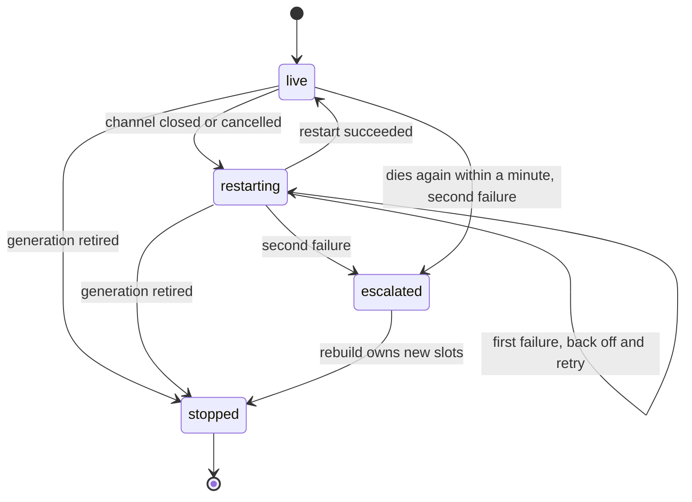

# RabbitMQ channel-level failure isolation

Status: ready-for-agent

## Problem Statement

A miso RabbitMQ client runs one supervisor that owns the connection and watches every channel opened on it. When any one channel dies, that supervisor retires the connection, re-dials the broker, and rebuilds every consumer and the whole publisher pool.

So a queue deleted under one consumer stops delivery on every queue the client consumes, for as long as the reconnect and the re-declaration take. A client that consumes ten queues loses all ten because one queue was cancelled. The rebuild also re-runs the full declaration path, so one unrelated declaration conflict keeps every healthy queue down.

## Solution

A dead channel restarts on its own, on the connection it already has, while the rest of the client keeps running.

The connection supervisor keeps ownership of the connection and stays the fallback. A channel that cannot be restarted in place, or that keeps dying, escalates to a full connection rebuild, which remains the only path that replaces the connection.

The isolated unit is one consumer listener, because that is the unit the client already opens a channel for. Publisher channels are pool entries rather than supervised slots. The pool drops a dead channel when it is next borrowed and opens a replacement on demand, so it never needs the supervisor.

## User Stories

1. As a service author, I want one deleted queue to affect only its own consumer, so that the other queues keep draining.
2. As an operator, I want a single channel death to cost seconds, not a reconnect window across the whole client.
3. As an operator, I want a channel that recovers by itself to leave the connection untouched, so that the broker never sees a reconnect storm.
4. As an operator, I want a channel that keeps dying to escalate to a connection rebuild, so that a broken connection still heals.
5. As an operator, I want a restart that re-declares the queue, so that a queue deleted under a consumer comes back instead of failing to consume forever.
6. As an operator, I want bounded log noise, so that a dead channel produces a few lines instead of one line per second.
7. As a maintainer, I want the slot logic testable without a broker, so that backoff and escalation are covered in the default test run.
8. As a maintainer, I want a generation teardown that stops its slots first, so that no restart runs against a connection already being retired.

## Implementation Decisions

### Slot ownership

Every generation holds a set of consumer slots, one per registered listener. A slot owns exactly one channel and never shares it. It reopens on the generation's connection, which AMQP allows concurrently. A channel open is an RPC serialized by the connection, and the connection object is safe for concurrent use.

The publisher pool gets no slots. Its channel count is a cache size, not an invariant. A publish borrows a live channel or opens one, and nothing needs to watch channels that are idle in the pool.

### Restart in place

A slot watches its channel for both close and cancel, as the client already does. A death moves it through a short cycle rather than through a connection rebuild.

One restart attempt does this:

1. Closes the channel whose death was just observed. A broker cancel leaves the channel open, so skipping this leaks one channel per cancel; an abnormal close is already gone and closing is a no-op.
2. Waits its in-place backoff, 250 milliseconds before the first attempt and 500 milliseconds before the second.
3. Opens a new channel on the current generation's connection and registers its close and cancel listeners before anything else, so a cancel that arrives during the subscribe is still observed.
4. Re-declares the listener's queue, the bindings that target that queue, and the exchanges and redeliver queues those bindings need.
5. Applies the quality-of-service setting, calls consume, and starts the handler goroutines.

Step 4 is what makes a cancelled consumer recover. A cancel usually means the queue was deleted or its policy changed, so a bare consume on the new channel would fail with a missing queue and keep failing. Declaration is idempotent, so re-declaring on a channel close that left the queue intact costs one round trip.

The publisher path needs no equivalent step, because publishing to an undeclared exchange fails the publish, not the channel, and the caller already sees that error.

### Escalation

A slot allows two in-place restarts. A restart fails when the attempt returns an error, or when the channel it opened dies before staying up for one minute. The second failure stops the slot and asks for a generation rebuild.

Escalation uses the generation's existing coalescing signal, so several slots escalating at once collapse into one rebuild. The connection supervisor answers it the way it answers a connection close. It retires the generation, backs off, and establishes a new one.

The slot resets its counter once a restarted channel has stayed up for a minute, so an occasional death never accumulates into an escalation.

### Generation teardown

Retiring a generation closes a done channel before it closes the connection. Slots select on that done channel in every wait, so a slot never opens a channel or escalates on a generation that is already being replaced. The supervisor waits for its slots with a bounded timeout before returning, so teardown is observable in tests and a slot that hangs cannot block a reconnect.

Closing the connection wakes each slot through its channel close notification, which is what makes the bounded wait terminate.

### Logging

A channel death logs one warning naming the cause: an abnormal close or a broker cancel. A clean close logs at debug. An in-place restart logs one warning naming the queue and the attempt number. An escalation logs one error naming the queue, and that error is the only error line a recovered restart can produce. A successful restart logs at debug level.

All of these carry the request rail, so the trace context survives.

### Semantics

Delivery stays at least once. The broker requeues unacknowledged deliveries when a channel closes, and the restarted consumer receives them again. Messages already acknowledged are not redelivered.

A channel death does not reorder messages across queues, because the client never guaranteed ordering across queues. Within one queue the broker's own ordering holds.

## Testing Decisions

The slot supervisor takes its channel open, start, and watch operations as functions, the way the connection supervisor already takes establish and retire. That seam lets a broker-free test drive the loop. Feed a death event, make the open fail twice, and assert one escalation. It also lets a test assert the counter reset by advancing the stable window instead of sleeping a minute.

Broker-free cases:

- One channel death restarts one slot and opens exactly one new channel.
- Two failed restarts produce one escalation and no third attempt.
- A restart that stays up past the stable window resets the counter.
- A slot exits without escalating when the generation is retired mid-backoff.
- Retiring a generation leaves no slot goroutine running.
- A pooled publisher channel that is already closed is dropped at borrow time and replaced through the demand path.

Live broker cases, opt in through the broker test switch:

- Deleting the queue behind one consumer makes that consumer come back and drain the re-declared queue, while the generation pointer is unchanged and a message published to a second queue is consumed without a gap.
- Killing the connection makes the supervisor rebuild the generation once, and every slot restarts on the new connection.
- A queue deleted repeatedly past the escalation limit produces exactly one connection rebuild.

## Out of Scope

- Supervisor logic for publisher channels. The pool heals them on demand.
- Per-slot metrics. Logs only, for now.
- Several connections, connection pools, or spreading consumers across connections.
- Handler-level isolation, meaning a slow handler or a panic inside a handler.
- Changes to redelivery, quality of service, or delayed retry semantics.
- Changes to connection-level backoff and the reconnect schedule.

## Further Notes

AMQP ties channel lifetime to the connection, and a connection-level error closes every channel. The connection supervisor therefore still decides when the connection is replaced; the slots only decide when a channel is. That split is the whole design.

A connection that is half dead, meaning TCP is open but the broker stopped answering, is not detected by this design. Detecting it needs a heartbeat or a probe, which is a separate concern from channel isolation.